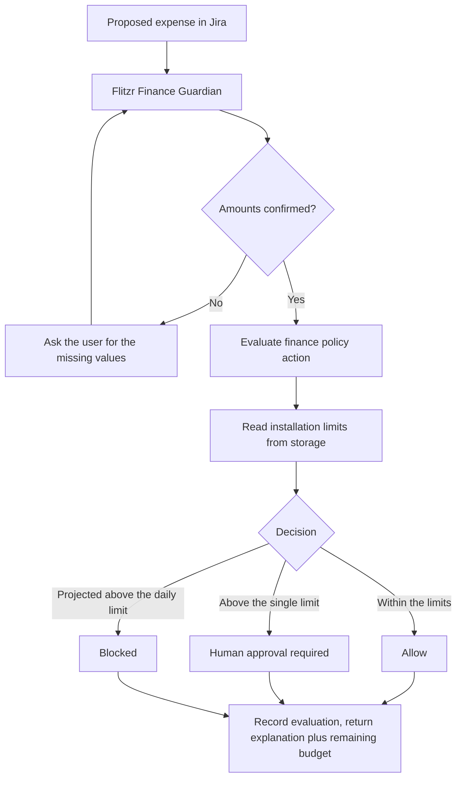

# Flitzr — Finance Guardian for Atlassian

**Understand the work. Check the spend. Keep humans in control.**

Flitzr is an Atlassian Forge prototype for reviewing proposed operational spending before anyone acts. A Rovo agent talks through the expense, and a deterministic policy action checks it against the installation's spending limits — configurable per site, with transparent demo defaults. Every evaluation is recorded in a short history, and the same check is available from a panel on Jira issues.

It combines:

- 🤖 **Rovo Agent** — Flitzr Finance Guardian, reviews proposed spending in Jira and Confluence
- ⚖️ **Policy Actions** — deterministic evaluation with strict input validation, no guessing, plus actions to read and change the limits and list recent evaluations
- 📋 **Jira Issue Panel** — run the same check from an issue and see the recent history
- 🔌 **MCP Tools** — the read-only tools (evaluate, get-limits, list-recent) for Rovo Studio and MCP-compatible AI clients
- 🛡️ **Human Control** — flags approval requirements; it never authorizes or executes payments
- 📊 **Demo Guardrails** — configurable USD limits per installation, demo defaults USD 25 single-expense and USD 100 daily

> Honest status: Flitzr is deployed to production (version 2.0.0), installed on a demo site, and verified end to end on 18 November 2026 — the Rovo agent evaluated a USD 20 expense against USD 30 already spent and returned the correct decision. The configurable limits, evaluation history, and Jira issue panel described here are implemented on the `feat/configurable-limits-history-panel` branch and are not yet deployed; deploy and live verification are ticket 05. This is a demo evaluation only, not a live finance system: no wallets, no bank accounts, no money moved.

## ✨ Product Surface

| Module | What it does |
| --- | --- |
| Rovo Agent | Talks through a proposed expense and confirms the amounts before evaluating |
| Policy Actions | Validate USD amounts and return a reproducible allow, approval, or blocked decision; read and change the limits; list recent evaluations |
| Jira Issue Panel | Runs the same check from a Jira issue and shows the recent history |
| MCP Server | Exposes the read-only tools (evaluate, get-limits, list-recent) for custom agents and MCP-compatible clients |
| Demo Policy | Configurable limits per installation, stored in Forge storage; demo defaults USD 25 single-expense and USD 100 daily |
| Safety Boundary | Evaluation only; no payments, no live balances, no signed transactions |

## 🔄 How it works

Proposed expense → Agent confirms amounts → Action validates → Decision → Explanation



The same check is available from the Flitzr panel on a Jira issue,
which calls the same handlers through Forge resolvers.

## Demo policy (illustrative only)

| Rule | Value |
| --- | ---: |
| Maximum single expense (demo default) | USD 25 |
| Maximum daily spend (demo default) | USD 100 |
| Single expense above the single limit | Human approval required |
| Projected daily spend above the daily limit | Blocked |

The limits are configurable per installation: ask the Rovo agent to
change them and every later evaluation on that site uses the new
limits. Until an installation sets its own, the demo defaults above
apply. New limits must be positive numbers, and the daily limit must
not be below the single limit. The limits are demonstration values.
They are not live balances, financial advice, or customer-configured
policies. Every successful evaluation is recorded in a history of the
most recent 20 evaluations; rejected inputs are not recorded.

## Install and try it

Install Flitzr on an Atlassian Cloud site with Rovo enabled (Rovo
requires a paid plan; a Standard or Premium trial includes it) using
the installation link:

https://developer.atlassian.com/console/install/0a82f923-7358-413b-b86f-0f88a9e53a47?signature=AYABeEAhf%2BkjQ%2BUOoBaJzLckiR4AAAADAAdhd3Mta21zAEthcm46YXdzOmttczp1cy13ZXN0LTI6NzA5NTg3ODM1MjQzOmtleS83MDVlZDY3MC1mNTdjLTQxYjUtOWY5Yi1lM2YyZGNjMTQ2ZTcAuAECAQB4CxqLTo9l4lqXuFjNim1xJM%2Bp%2F3TVP9xHS2BrU5DRRucBpIdHuyGQrMLmmRtRx4AVJgAAAH4wfAYJKoZIhvcNAQcGoG8wbQIBADBoBgkqhkiG9w0BBwEwHgYJYIZIAWUDBAEuMBEEDHrNsZ6WZ1v5l24HjAIBEIA7C9HJpD79XF6EtsoXTfp7seGUw252rGB3RCq2yKH8TKM3ETRITAsTrX375%2FLfPc819ko7YPTsGrivZKwAB2F3cy1rbXMAS2Fybjphd3M6a21zOmV1LXdlc3QtMTo3MDk1ODc4MzUyNDM6a2V5LzQ2MzBjZTZiLTAwYzMtNGRlMi04NzdiLTYyN2UyMDYwZTVjYwC4AQICAHi9bVMAkme4qVQX1fQHo6ePw3H40A7cGfz7yrmSfBWMXgETn5MW%2B%2FEGzq%2B5JvIi9kWcAAAAfjB8BgkqhkiG9w0BBwagbzBtAgEAMGgGCSqGSIb3DQEHATAeBglghkgBZQMEAS4wEQQML%2BkVWfydNPqIILWLAgEQgDu82RjZuMGFeewjwIDrTiGp4QrzHCoGy4%2BPHaEJtmlVAeYsFqKlukqCNxBfV2%2B%2BSEbriEAE7%2BmVj7csVAAHYXdzLWttcwBLYXJuOmF3czprbXM6dXMtZWFzdC0xOjcwOTU4NzgzNTI0MzprZXkvNmMxMjBiYTAtNGNkNS00OTg1LWI4MmUtNDBhMDQ5NTJjYzU3ALgBAgIAeDYASx0XCjkny4iLV6vz%2BKtEGSGT6kdt0QRpkn6D%2FlVEAU1n%2FDAgwnH6bkTBguWEUU0AAAB%2BMHwGCSqGSIb3DQEHBqBvMG0CAQAwaAYJKoZIhvcNAQcBMB4GCWCGSAFlAwQBLjARBAwQGFZpWFHCIv0VJj4CARCAO4SHvJ4pWZU1enVZg6zj1t41ITkIxgVAGDtguqsVLW%2F%2FH91ErXfplBoN6de4ZHqtPtdl%2BxQlEVHf9YqhAgAAAAAMAAAQAAAAAAAAAAAAAAAAANOkJngBqIDz8jHVQjxn3tf%2F%2F%2F%2F%2FAAAAAQAAAAAAAAAAAAAAAQAAADLdnqJgQMyeftCBLEYuhWZmg7IPgw7Aqyf9MDDli7IHWaHBgOEjaBevJJIvnaWY%2F2HnwUkiaKUJUl6IYB7VX%2B9zpZo%3D&product=jira

Then open Flitzr Finance Guardian in Rovo Chat and try the demo cases:

- USD 20 expense with USD 30 already spent today: allowed, projected
  daily spend USD 50, remaining demo budget USD 50.
- USD 30 expense with USD 20 already spent today: within the daily
  budget, but human approval is required (above USD 25).
- USD 21 expense with USD 80 already spent today: blocked, projected
  daily spend would be USD 101.

Ask the agent "What are our current spending limits?" to see the
limits, "Set the single limit to USD 50 and the daily limit to USD
200" to change them, and "What did we check recently?" to see the
evaluation history. On a Jira issue, open the Flitzr Finance Guardian
panel to run the same check and see the same history.

The read-only tools (evaluate, get-limits, list-recent) are also
exposed as MCP tools ("Flitzr Finance Controls") at
`https://mcp.atlassian.com/forge/0a82f923-7358-413b-b86f-0f88a9e53a47`.
Set-limits is deliberately not exposed through MCP: changing limits
stays a deliberate step through the Rovo agent. External MCP exposure
is disabled by default; a site or org admin enables it per
installation under Apps > Sites > your site > Connected apps. Full
judge instructions live in `docs/SUBMISSION.md`.

## Safety boundary

This Forge app is an **evaluation-only prototype**. It does not connect to wallets or bank accounts, fetch verified financial balances, sign transactions, submit orders, transfer funds, or broadcast transactions. It must never claim that money moved.

The action requires an explicit proposed amount and an explicit confirmed daily-spend value. Missing, blank, malformed, negative, or non-finite values are rejected rather than guessed.

## Runtime layers

| Layer | Responsibility |
| --- | --- |
| Rovo agent | Understands the request, confirms the amounts, never invents values |
| Forge actions | Validate inputs, evaluate the policy deterministically, read and change limits, list history |
| Forge storage (KVS) | Holds the installation limits and the 20 most recent evaluations, scoped per installation |
| Jira issue panel | Runs the same check from an issue through Forge resolvers |
| Forge platform | Runs the code and serves the agent, panel, and MCP tools |
| Human reviewer | Makes the final call on approvals and blocked spend |

## Repository layout

- `manifest.yml` — Forge app, Rovo agent, actions, issue panel, and MCP declarations.
- `src/index.js` — deterministic policy evaluator, storage-aware action handlers, and panel resolvers.
- `src/storage.js` — thin Forge Key-Value Store wrapper (limits + history).
- `src/frontend/index.jsx` — Jira issue panel (UI Kit).
- `test/` — built-in Node.js tests (38 tests: policy, storage, handlers, panel resolvers).
- `GLOSSARY.md` — domain language for the project.
- `docs/adr/` — architecture decision records (0001–0004).
- `docs/ARCHITECTURE.md` — request flow and trust boundaries.
- `docs/AUDIT-2026-11-18.md` — full audit report.
- `docs/CODEGEIST-2026.md` — project scope and remaining work.
- `docs/DEMO_SCRIPT.md` — demo outline.
- `docs/PRODUCTION_CHECKLIST.md` — validation and release checklist.
- `docs/RESEARCH-forge-2026-11-25.md` — Forge research behind the upgrade (KVS, UI Kit, Rovo actions).
- `docs/SECURITY.md` — security boundary and threat considerations.
- `docs/SUBMISSION.md` — Devpost submission draft and judge instructions.
- `LICENSE` — MIT license.

## Local checks

Requires Node.js 20 or newer.

```bash
npm test
```

Install and authenticate the Atlassian Forge CLI separately, then run:

```bash
forge lint
forge install --help
```

The app is deployed to development and production (version 2.0.0) and
was installed and verified on a demo site on 18 November 2026; see
`docs/SUBMISSION.md` for the current status.

## App identity

The registered Forge app ID is configured in `manifest.yml`. Do not run `forge register` again unless Atlassian app registration has been deliberately reviewed; re-registering can create a different app identity.

## Project links

- Live landing page: https://flitzr-lxug.vercel.app/
- Repository: https://github.com/wadezigh96/Flitzr
- Atlassian Forge build and launch guide: https://developer.atlassian.com/platform/forge/build-and-launch-your-forge-app/
- Codegeist 2026: https://codegeist2026.devpost.com/
